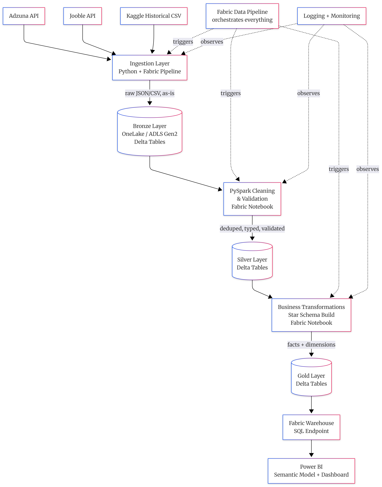
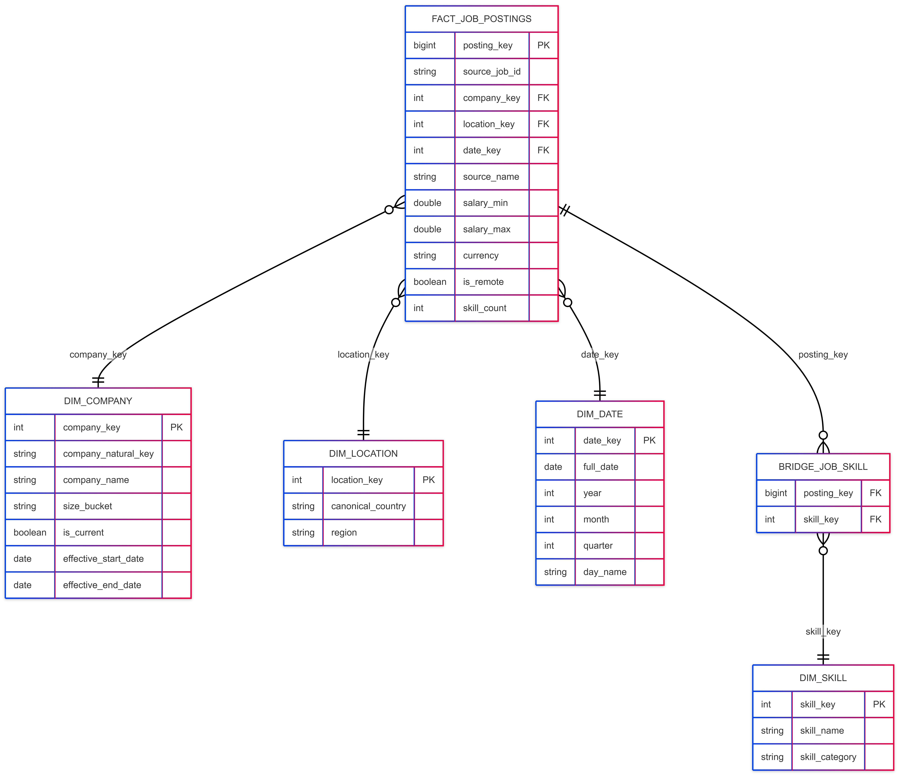

# Job Market Analytics Platform

An end-to-end data platform that ingests live job postings from multiple job-board
APIs, cleans and deduplicates them across sources, models them into a star schema,
and surfaces hiring trends, in-demand skills and salary insights in Power BI. It is
built on Microsoft Fabric's Lakehouse (medallion) architecture, and the whole
pipeline also runs locally on PySpark + Delta Lake.

**Why it exists:** to practise production-style data engineering (medallion layers,
idempotent loads, data-quality quarantine, SCD Type 2, metadata-driven
orchestration, tested pipeline logic) on live, messy data instead of a cleaned-up
tutorial dataset.

## Questions it answers

- Which skills are most in demand, and how is that changing over time?
- Which companies are hiring most actively?
- How does salary vary by technology and location?
- What is the remote vs. on-site split?

## Architecture



```
Adzuna API ─┐
            ├─→ raw JSON ─→ Bronze (Delta) ─→ Silver (clean, deduped, Delta) ─→ Gold (star schema, Delta) ─→ Power BI (DirectLake)
Jooble API ─┘                                     │
                                                  └─→ Quarantine (rows that fail critical DQ rules)
```

| Layer | What happens | Write pattern | Code |
|---|---|---|---|
| **Landing** | Each connector writes one JSON file per source, country and run | New file per run | [ingestion/run_ingestion.py](ingestion/run_ingestion.py) |
| **Bronze** | Raw postings loaded with an explicit schema, partitioned by `ingestion_date` | Dynamic partition overwrite, so re-runs are idempotent | [transformation/bronze_writer.py](transformation/bronze_writer.py) |
| **Silver** | Location standardisation, salary parsing, cross-source dedup, DQ rule engine | Clean rows go to Silver, failed rows to a quarantine table | [transformation/bronze_to_silver.py](transformation/bronze_to_silver.py), [transformation/dq_checks.py](transformation/dq_checks.py) |
| **Gold** | Star schema: `fact_job_postings`, `bridge_job_skill`, `dim_company` (SCD2), `dim_location`, `dim_skill`, `dim_date` | MERGE / upsert | [transformation/silver_to_gold.py](transformation/silver_to_gold.py), [transformation/dim_builders.py](transformation/dim_builders.py) |



## Key engineering decisions

- **Config-driven, pluggable connectors.** Sources are declared in
  [config/sources.yaml](config/sources.yaml). Adding a job board means one
  `BaseConnector` subclass and one registry entry; no pipeline code changes.
- **Secrets stay out of code.** [utils/config_loader.py](utils/config_loader.py) is the
  only module that reads credentials from the environment, and it fails loudly on a
  missing key rather than letting a `None` turn into a confusing 401 later.
- **Deterministic deduplication.** Adzuna and Jooble often list the same job. Silver
  ranks duplicates with a window function and an explicit `SOURCE_PRIORITY` (Adzuna's
  structured salary beats Jooble's free text), instead of relying on
  `dropDuplicates()`'s arbitrary choice of row.
- **Quarantine, don't drop.** DQ rules are tagged `CRITICAL` (row is quarantined) or
  `WARNING` (row is flagged but kept), so bad data stays visible and can be audited.
- **Salary parsing via a Pandas UDF.** Used only where built-in Spark functions can't
  parse Jooble's free-text salaries ([transformation/salary_parser.py](transformation/salary_parser.py)).
- **SCD Type 2 only where it pays off.** Only `dim_company` keeps history. The other
  dimensions are plain upserts.
- **Partial data beats no data.** Each source is ingested in isolation. Silver and Gold
  run if at least one source succeeded, and a Teams alert flags the window as
  incomplete.
- **Metadata-driven orchestration.** A control table
  ([sql/ddl/create_pipeline_control.sql](sql/ddl/create_pipeline_control.sql)) drives a
  Lookup + ForEach in the Fabric pipeline, so enabling or disabling a source is a data
  change, not a redeploy.
- **Tumbling-window trigger.** Each run receives its own window date, so backfilling a
  missed day produces that day's values (including SCD2 effective dates), not today's.
- **DirectLake on physical tables.** The Power BI model binds straight to Gold Delta
  tables (with a materialised `dim_company_current`) so it doesn't silently fall back
  to DirectQuery.

## Tech stack

Python 3.11 · PySpark · Delta Lake · Pandas / PyArrow · Microsoft Fabric (Lakehouse,
Notebooks, Data Pipelines) · Power BI (DirectLake, DAX) · pytest

## Getting started (local)

### Prerequisites

- Python 3.11+
- Java 8/11/17 on `PATH` (needed by PySpark)
- Free API keys from [Adzuna](https://developer.adzuna.com/) and
  [Jooble](https://jooble.org/api/about)

### Setup

```bash
python -m venv venv
venv\Scripts\activate          # Windows; use `source venv/bin/activate` on macOS/Linux
pip install -r requirements.txt
```

Create a `.env` file in the project root (it is git-ignored):

```dotenv
ADZUNA_APP_ID=your_app_id
ADZUNA_APP_KEY=your_app_key
JOOBLE_API_KEY=your_api_key
APP_ENV=local                  # local | ci | fabric

# Optional
TEAMS_WEBHOOK_URL=             # pipeline alerts; if unset, alerts are only logged
SPARK_MASTER=local[2]
```

### Run

Run all commands from the project root.

```bash
# Unit tests (no API keys or network needed)
pytest

# Ingestion only: fetch postings and write raw JSON to data/bronze/
python -m ingestion.run_ingestion

# Full pipeline for one window: ingest → Bronze → Silver → Gold Delta tables under data/delta/
python -m pipelines.local_orchestrator             # today's window
python -m pipelines.local_orchestrator 2026-10-01  # a specific window (backfill)
```

Both commands exit non-zero on any partial failure, so a scheduler or CI job can't
report a green run on incomplete data. Logs are written to `logging/logs/`.

## Running on Microsoft Fabric

1. Create a Fabric workspace (the trial capacity is enough) and a Lakehouse.
2. Upload `config/` (including `config/reference/*.csv`) to the Lakehouse `Files/`.
3. Import the notebooks in order:
   [01_bronze_ingestion](notebooks/01_bronze_ingestion.ipynb) →
   [02_silver_cleaning](notebooks/02_silver_cleaning.ipynb) →
   [03_gold_transformation](notebooks/03_gold_transformation.ipynb).
   They call the same tested modules in `ingestion/` and `transformation/` and don't
   duplicate any logic.
4. Run the DDL in [sql/ddl/](sql/ddl/), including the pipeline control table.
5. Import [master_pipeline.json](pipelines/fabric_pipeline_definitions/master_pipeline.json)
   and [tumbling_window_trigger.json](pipelines/fabric_pipeline_definitions/tumbling_window_trigger.json).
   The trigger is shipped in the `Stopped` state.
6. Build the Power BI semantic model using
   [powerbi/model_relationships.md](powerbi/model_relationships.md) and
   [powerbi/dax_measures.md](powerbi/dax_measures.md).

Storage paths for Fabric are noted in [config/config.yaml](config/config.yaml). Plain
Python I/O uses `/lakehouse/default/Files/...`, while Spark uses lakehouse-relative
`Tables/...` paths.

## Project structure

| Path | Purpose |
|---|---|
| [config/](config/) | App settings, source definitions, logging config, country reference data |
| [ingestion/](ingestion/) | `BaseConnector`, Adzuna and Jooble connectors, connector factory, CLI entry point |
| [transformation/](transformation/) | Bronze writer, Silver cleaning and dedup, DQ rules, salary parser, skill taxonomy, Gold builders |
| [pipelines/](pipelines/) | Fabric pipeline and trigger JSON, plus `local_orchestrator.py` (the same orchestration logic in plain Python, for local runs and tests) |
| [notebooks/](notebooks/) | Fabric notebooks for Bronze, Silver and Gold |
| [sql/ddl/](sql/ddl/) | DDL for Gold tables and the pipeline control table |
| [powerbi/](powerbi/) | DAX measure library and semantic-model relationship checklist |
| [tests/unit/](tests/unit/) | pytest suite covering connectors, Bronze/Silver/Gold logic, DQ rules, parsers and the orchestrator |
| [utils/](utils/) | Config loader and logging (with a per-run `run_id`) |
| [docs/](docs/) | Chapter-by-chapter build guide (architecture → ingestion → Spark → Delta → orchestration → Power BI → testing → portfolio) |
| [images/](images/) | Architecture and data-flow diagrams |

## Adding a new data source

1. Add an entry to [config/sources.yaml](config/sources.yaml) with `enabled: false`.
2. Subclass `BaseConnector` ([ingestion/base_connector.py](ingestion/base_connector.py))
   and implement `_build_request`, `_parse_response` and `_has_more_pages`.
3. Register the class in [ingestion/connector_factory.py](ingestion/connector_factory.py).
4. Add the source to the control table seed in
   [sql/ddl/create_pipeline_control.sql](sql/ddl/create_pipeline_control.sql). It is
   kept in sync with `sources.yaml` by hand.
5. Set `enabled: true` once it's tested.

`usajobs` is already listed in `sources.yaml` as a disabled placeholder.

## Status

Portfolio/learning project. Not affiliated with Adzuna, Jooble or Microsoft.
